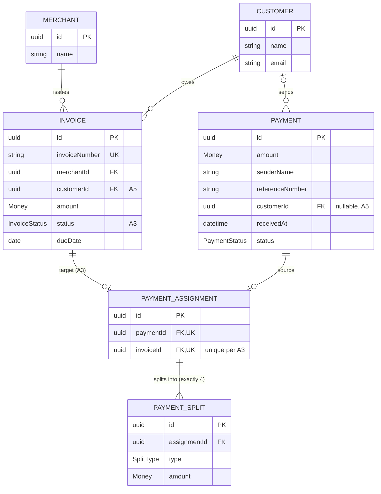

# Data Model

Data model for the Payment Management Interface described in [Payment Management Interface.md](./Payment%20Management%20Interface.md). References like `A3` point to [assumptions.md](./assumptions.md).

## Entities



| Entity | Role |
|---|---|
| `Payment` | Incoming payment without an automatic invoice match. The starting point of the page. |
| `Invoice` | Claim against a customer, issued by a merchant. The assignment target. |
| `Merchant` | Issues invoices and receives the `MERCHANT_PAYOUT` split. |
| `Customer` | The sender found in the database (A5). |
| `PaymentAssignment` | Created on confirmation. Links one payment to one invoice. |
| `PaymentSplit` | One of the four positions of an assignment. |

`Payment`, `Invoice`, `Merchant` and `Customer` already exist and are read-only on this page. `PaymentAssignment` and `PaymentSplit` are created only when the user confirms.

## Value types

| Type | Values | Notes |
|---|---|---|
| `Money` | `{ amountMinor, currency }` | Integer cents, e.g. `124900` = €1,249.00 (A8) |
| `PaymentStatus` | `UNMATCHED`, `ASSIGNED` | The page edits only `UNMATCHED` payments |
| `InvoiceStatus` | `OPEN`, `PAID` | Only `OPEN` invoices are offered by the search (A3). The backend decides any status change after assignment (A4). |
| `SplitType` | `PLATFORM_FEE`, `PROVIDER_FEE`, `LOGISTICS_FEE`, `MERCHANT_PAYOUT` | Each type exactly once per assignment |

## TypeScript types

```ts
type Money = { amountMinor: number; currency: 'EUR' };

type PaymentStatus = 'UNMATCHED' | 'ASSIGNED';
type InvoiceStatus = 'OPEN' | 'PAID';
type SplitType = 'PLATFORM_FEE' | 'PROVIDER_FEE' | 'LOGISTICS_FEE' | 'MERCHANT_PAYOUT';

interface Payment {
  id: string;
  amount: Money;
  senderName: string;
  referenceNumber: string;
  customerId: string | null;
  receivedAt: string;               // ISO 8601
  status: PaymentStatus;
}

// API shape: merchantId is resolved to { id, name } so search results and
// the confirmation modal can show the merchant name without a second request.
interface Invoice {
  id: string;
  invoiceNumber: string;            // plain number, e.g. "418" (A9)
  merchant: { id: string; name: string };
  customerId: string;
  amount: Money;
  status: InvoiceStatus;
  dueDate: string;
}

interface PaymentSplit {
  type: SplitType;
  amount: Money;
}

interface PaymentAssignment {
  paymentId: string;
  invoiceId: string;
  splits: PaymentSplit[];           // exactly 4, sum = payment.amount
}
```

## Frontend state

Store only what the user enters. Derive everything else on each render so the values cannot drift apart.

React Aria's `NumberField` parses the input with the active locale's separators (D1) and blocks negative values, so
the draft holds cents, not raw strings (`ui/src/domain/split.ts`, `ui/src/domain/money.ts`):

```ts
// cents; null = empty field; { tooPrecise } = more than two decimals, kept as typed euros instead of rounded
type AmountInput = number | null | { tooPrecise: number };

interface SplitDraft {
  fees: Record<'PLATFORM_FEE' | 'PROVIDER_FEE' | 'LOGISTICS_FEE', AmountInput>; // start empty
  merchantOverride: AmountInput; // null = use the calculated payout (A1)
}

// useAssignmentFlow state: the invoice, the open modal, plus useSplitDraft(payment.amount) for the split
invoice: Invoice | null; // cleared when the server rejects it (INVOICE_NOT_OPEN, INVOICE_NOT_FOUND) and the modal closes
isConfirming: boolean; // keeps the form mounted while the modal is open, even if a refetch finds the payment ASSIGNED
draft: SplitDraft;
touchedFees: Set<FeeType>; // fees whose "missing" error is shown, i.e. the user has left the field

// derived on each render inside useSplitDraft, never stored
const evaluation = evaluateSplit(payment.amount.amountMinor, draft);
// → { calculatedPayout, displayedPayout, isOverridden, fieldErrors, error, validSplit }
// validSplit: all four amounts once there is no error left, else null (what the modal confirms)

// local to the confirmation modal, reset on every opening
isAcknowledged: boolean; // difference to the invoice amount checked (A4)
```

The *Review and confirm* button below the steps is always enabled. It opens the modal once an invoice is selected and
`validSplit` is set. Otherwise it shows every error at its field (the invoice search, all fees) and moves focus to the
first problem on the page, or to the split error if no single field is wrong. The modal is the summary: it shows `validSplit` and sends it as the four `PaymentSplit`s, so the server receives
exactly the amounts shown in it.

An override equal to the calculated payout is stored as `null` (`withMerchantPayout`), so it does not stay as a stale
manual value.

Server data (the payment and invoice search results) is server state, for example via TanStack Query. The draft is local form state.

## Split calculation

All values are in cents.

```
suggestedPayout = payment − (platformFee + providerFee + logisticsFee)
difference      = payment − (platformFee + providerFee + logisticsFee + merchantPayout)
```

| Position | Amount | Share |
|---|---:|---:|
| Payment | €1,249.00 | 100.00 % |
| Platform fee | −€62.45 | 5.00 % |
| Payment provider fee | −€18.74 | 1.50 % |
| Logistics fee | −€14.90 | 1.19 % |
| **Merchant payout** | **€1,152.91** | 92.31 % |

`124900 − (6245 + 1874 + 1490) = 115291`. If the user overrides the payout with €1,143.91, then `difference = 900`, which is reported as €9.00 missing.

## Validation

Messages are react-intl ICU messages with locale-formatted amounts (D1). The examples are shown in `en`.

| Rule | Severity | Basis | Example message |
|---|---|---|---|
| Invoice is provided | blocking | Spec: "missing data" | Enter an invoice number or select an invoice from the list. |
| Invoice number exists and the invoice is `OPEN` (the search returns only open invoices) | blocking | Spec: "invalid invoice numbers", A3 | No open invoice found for 9999. Check the number or search by merchant. |
| Each fee is entered (shown after leaving the field or pressing the confirm button). Fees start empty, so 0 is always a deliberate choice | blocking | Spec: "missing data" | Enter the fee. Use 0 if there is none. |
| Each amount is a number in the active locale, ≥ 0 and ≤ €1,000,000,000 | prevented | Spec: "correct data types and values", D1 | – (the field rejects other characters and negative input, and clamps larger values) |
| At most 2 decimal places | blocking | Derived: the cent is the smallest EUR unit | Amounts can have at most two decimal places. |
| Σ fees ≤ payment amount | blocking | Spec: "incorrect fee calculations" | The fees exceed the payment amount by €12.40. |
| Σ of all four positions = payment amount, checked once all fields are valid | blocking | Spec: "incorrect fee calculations" | The split totals €1,240.00 but the payment is €1,249.00 (€9.00 missing). Action: *Use calculated value* |
| Invoice is still `OPEN` on the server | blocking | A3 | The invoice is no longer open. Go back and select a different invoice. |
| Payment amount = invoice amount | warning | A4 | The payment is €50.00 lower than the invoice amount. You can still assign it. You will confirm the difference in the last step. |
| Mismatch acknowledged in the modal | blocking | A4 | Confirm that you have checked the €50.00 difference. |
| Payment is still `UNMATCHED` on the server | blocking | A10 | This payment is already assigned. It can no longer be assigned to another invoice. Action: *Show current state* |

## API

Proposed contract (A10), served by the MSW mock in `ui/src/mocks/` during development. All paths are relative to `/api`.

| Endpoint | Response | Purpose |
|---|---|---|
| `GET /payments?q=&status=UNMATCHED&offset=0&limit=10` | `Page<Payment>` | Choose the payment in the first step (A12) |
| `GET /payments/{paymentId}` | `Payment` | Load the payment, also when it is already `ASSIGNED` |
| `GET /invoices?q=&customerId=&offset=0&limit=10` | `Page<Invoice>` | Autocomplete and lookup of a typed invoice number |
| `POST /payments/{paymentId}/assignment` | `201 PaymentAssignment` (`200` for a repeat) | Confirm the assignment with all four splits |

### Payment search

- `q` matches the payment id, sender name and reference, case-insensitive. Max. 100 characters.
- `status` is required and must be `UNMATCHED`, the only status the UI searches for.
- The order is total: exact id match, then `receivedAt` ascending (the payment that has waited longest first), then `id`.
- Offset pagination like the invoice search: `offset` ≥ 0, `limit` 1–50 (default 10), response `{ items, total, offset, limit }`.

### Invoice search

- `q` matches the invoice number and merchant name, case-insensitive. Max. 100 characters.
- `customerId` ranks that customer's invoices first and does **not** filter (A5).
- Only `OPEN` invoices are returned, the only ones a payment can be assigned to (A3). A typed number of a paid invoice is
  therefore reported as not found; the server still rejects an invoice paid in the meantime with `INVOICE_NOT_OPEN`.
- The order is total, so pages never overlap: exact number match, the customer's invoices, `dueDate`, `invoiceNumber`.
- Offset pagination: `offset` ≥ 0, `limit` 1–50 (default 10). The response is `{ items, total, offset, limit }`.
- There is no `sort` parameter. The autocomplete only needs relevance order.

### Assignment

The request is `{ invoiceId, splits }` with all four splits, including `MERCHANT_PAYOUT`, so the server checks exactly the values shown in the confirmation modal. A difference between payment and invoice amount is not rejected (A4). On success the payment becomes `ASSIGNED` and the invoice `PAID`.

The request is idempotent: once the payment is assigned, the same `invoiceId` with the same amount per split type returns `200` with the stored assignment. A retry after a lost response (timeout, 5xx) therefore succeeds instead of reporting the client's own assignment as `PAYMENT_ALREADY_ASSIGNED`.

### Errors

RFC 9457 problem details (`application/problem+json`): `{ status, code, title, errors?: [{ field, code }] }`. The UI maps `code` to a message id and never shows `title` (D1).

| Status | `code` | Cause |
|---|---|---|
| 400 | `INVALID_QUERY` | Invalid search parameters, including a payment `status` other than `UNMATCHED` |
| 404 | `PAYMENT_NOT_FOUND` | Unknown payment id |
| 409 | `PAYMENT_ALREADY_ASSIGNED` | Payment is no longer `UNMATCHED` and the request differs from the stored assignment |
| 409 | `INVOICE_NOT_OPEN` | Invoice is not `OPEN` or already assigned (A3) |
| 422 | `INVOICE_NOT_FOUND` | Unknown `invoiceId` in the request body |
| 422 | `VALIDATION_FAILED` | Not exactly one split per type, or an amount that is not an integer ≥ 0 in EUR |
| 422 | `SPLIT_SUM_MISMATCH` | The splits do not add up to the payment amount |
| 500 | `INTERNAL_ERROR` | Server error |

## Design rationale

### Why splits belong to the assignment, not the invoice

- An invoice is what is owed. Splits distribute money that was actually received.
- Splits are part of the confirmed decision and are created or reversed with it.
- Adding partial payments later (A3) only drops `unique` on `invoiceId`.

### Why integer cents

Floating point is inexact: `1249 - 62.45 - 18.74 - 14.90` gives `1152.9099999999999` in JavaScript.

- Sums compare exactly, with no epsilon needed.
- Parse locale input strings directly to cents. Do not use `parseFloat(x) * 100`.
- Format only for display, with react-intl (D1).
